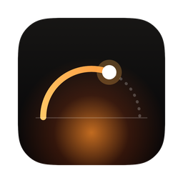
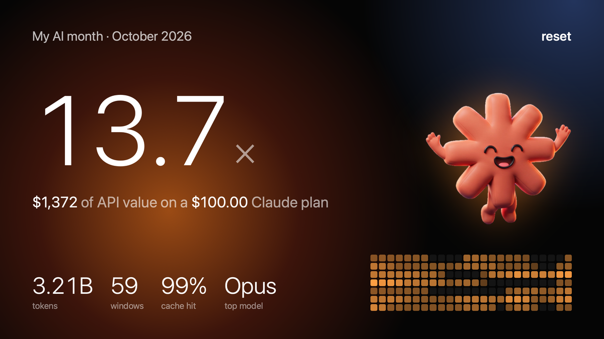
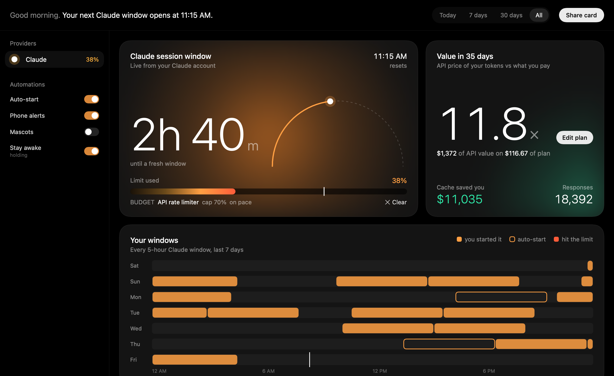
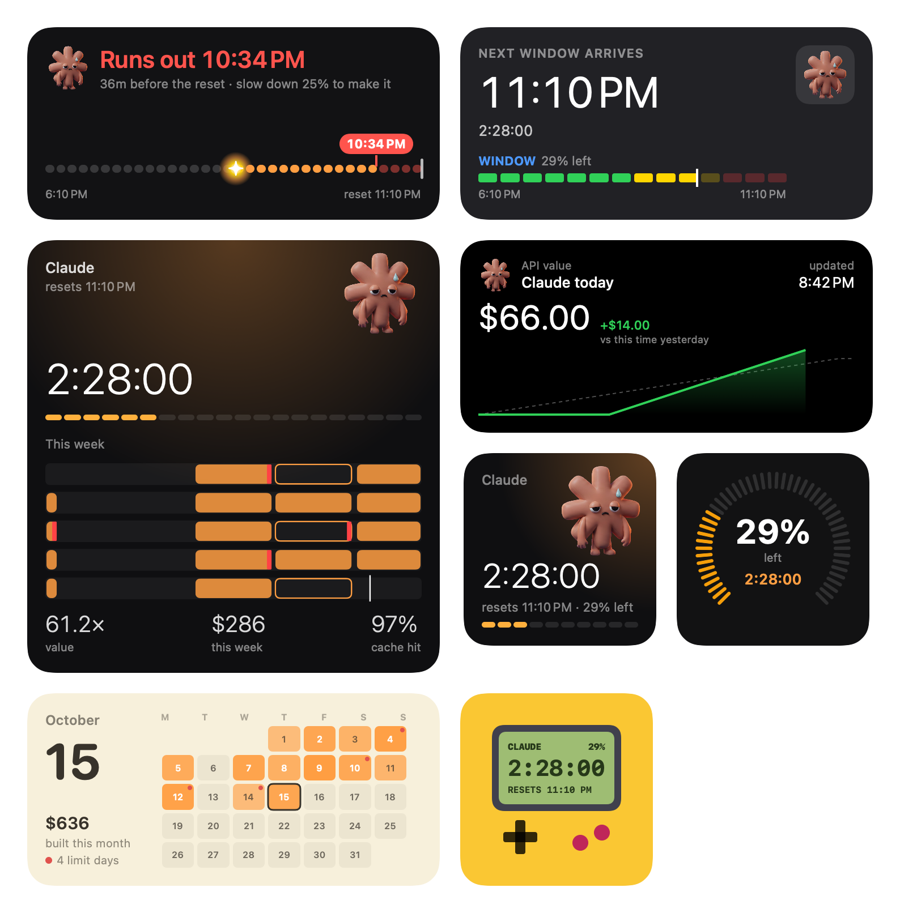
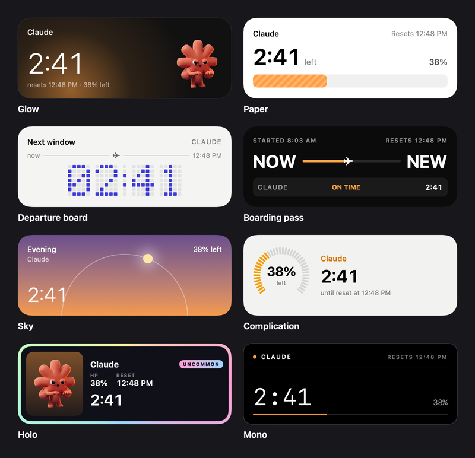

<p align="center"></p>

<h1 align="center">Reset</h1>

<p align="center">Know exactly when your AI usage window resets, get pinged on your phone when it does, and see what your usage is actually worth.</p>

<p align="center"></p>

Reset is a free, open source macOS app for people who live inside Claude Code (with Codex, Gemini CLI and Antigravity support too). It sits in your menu bar, counts down to your next fresh window, and turns your local usage logs into a dashboard, desktop widgets and a card you can post.

Everything it reads stays on your Mac.

## What it does

- **Countdown to your next window.** A menu bar timer for Claude's 5-hour session window, exact when live usage is on and estimated from your activity when it isn't.
- **Phone alerts while your Mac sleeps.** Reset queues each reset alert on an [ntfy](https://ntfy.sh) server ahead of time, so it arrives on your phone even with the lid closed.
- **Limit forecast.** At your current pace, will you hit the limit before the reset? Reset warns you once per window, on your Mac and your phone.
- **Auto-start.** Optional. When a window runs out, Reset sends a one-word prompt so the next window starts right away instead of when you wake up.
- **Dashboard.** API-price value of your usage against your plan, cache savings, every 5-hour window of the week, token mix, when you build, cost per session and per project, and what used each session (main thread, subagents, each MCP server).
- **8 desktop widgets**, including **Fuse**: your window as a burning fuse, with where today's pace runs out and how much to slow down to make the reset. The others: countdown, gauge, arrival, today's spend, month calendar, week, and a Game Boy. When a fresh window is waiting, the countdown and Fuse widgets show a **Start now** button that starts it right from your desktop. Plus **8 looks** for the menu card.
- **Mascots.** Animated desktop pets whose mood and health bar follow your usage: fresh, focused, tired, asleep at the limit, waking at the reset.
- **Share card.** A 1200 × 675 image of your month for X.
- **Claude Code integration.** A status line for your terminal and an MCP server, so Claude can check how much window is left and pace itself, including a per-task budget that tells it when to wrap up or switch to a smaller model.
- **Stay awake.** Keeps the Mac from idle-sleeping (when plugged in, or always) so auto-start and alerts run on time, without a separate app. The display still sleeps.
- **One-minute setup.** A first-run guide picks your tools, signs Claude Code in, sets up phone alerts with a QR code, and takes your plan price.

<p align="center"></p>

<p align="center"></p>

<p align="center"></p>

## Install

**Download:** grab the latest `.dmg` from [Releases](https://github.com/msfbeast/reset/releases/latest), open it and drag Reset to Applications.

Reset isn't notarized yet, so macOS blocks the first launch. Open Reset once, close the warning, then go to **System Settings → Privacy & Security** and click **Open Anyway** next to Reset. You only do this once. (Or run `xattr -dr com.apple.quarantine /Applications/Reset.app` in Terminal.)

The download is ad-hoc signed, so its widgets won't appear. For widgets, build it yourself as below.

**Build from source** (about two minutes):

You need macOS 14 or later, Xcode 16 or later, and [XcodeGen](https://github.com/yonaskolb/XcodeGen):

```bash
brew install xcodegen
git clone https://github.com/msfbeast/reset.git
cd reset
./scripts/build.sh --install
```

That builds an ad-hoc signed app and copies it to `/Applications`.

**Widgets need a real signature.** macOS only lists widgets from apps signed with an Apple Development certificate. If you're signed in to Xcode with any Apple ID (a free one works), pass your team ID:

```bash
TEAM=ABCDE12345 ./scripts/build.sh --install
```

Find your team ID in Xcode under Settings → Accounts, or in Keychain Access on your "Apple Development" certificate.

## Setting it up

The first launch opens a short setup guide that covers all of this. You can run it again from **Settings → Advanced**, or change anything below in **Settings**, which has four tabs: **General** (live usage, your tools, alerts), **Automation** (auto-start, stay awake), **Appearance** (look, mascots) and **Advanced** (commands, custom tools, Claude Code integration, diagnostics).

| Feature | How |
|---|---|
| Exact Claude usage | **Settings → General**: turn on **Live usage from your Claude account**. Reset reads the sign-in that the Claude Code CLI stores in your Keychain and asks Anthropic for your current usage every 3 minutes. If it says the sign-in expired, run `claude auth login` once. |
| Phone alerts | Install the free ntfy app, subscribe to a long random topic name, and enter the same topic under **Settings → General → Phone alerts**. Anyone who knows the topic can read it, so make it unguessable. |
| Auto-start | **Settings → Automation**: turn on **Auto-start** for Claude. It runs `claude -p "hi" --model haiku` (the command is under Advanced) once when a window you were watching runs out, while the Mac is awake. Each run uses a little of your quota. |
| Value multiple | Press **Add your plan price** on the dashboard and enter what you pay per month. |
| Stay awake | **Settings → Automation → Stay awake**: Off, When plugged in, or Always. Blocks idle sleep only; closing the lid still sleeps the Mac unless it's plugged in with an external display. |
| Status line | **Settings → Advanced** has a Copy button, or add to `~/.claude/settings.json`: `"statusLine": {"type": "command", "command": "cat \"$HOME/Library/Application Support/Reset/statusline.txt\""}` |
| MCP server | `claude mcp add --scope user reset -- /Applications/Reset.app/Contents/MacOS/reset-mcp`. Tools: `get_claude_usage`, plus `set_budget` (task, max window %, optional downshift model) and `clear_budget`. With a budget set, the advice moves from normal to wrap-up at 80% of the cap to downshift at the cap. The active budget shows under the burn bar on the dashboard, with a Clear button. It's kept in `budget.json` next to `widget.json` and never leaves the Mac. |

## Privacy

Reset reads local files only:

- Claude Code transcripts in `~/.claude/projects`. Reset scans them for usage and keeps only token counts, models, timestamps, tool and MCP names, project folders and session titles, in a cache in `~/Library/Application Support/Reset`. Your prompts and Claude's replies are never stored.
- `~/Library/Application Support/Claude/plan-usage-history.json` from the Claude desktop app
- Codex session logs in `~/.codex/sessions`
- Antigravity's local language server, while Antigravity is open

It only sends anything off your Mac for these features, and only to the place you'd expect:

- **Live Claude usage** sends Claude Code's sign-in to `api.anthropic.com` to read your usage. Reset never stores, refreshes or rewrites that sign-in.
- **Phone alerts** send the alert text to the ntfy server you choose. The text is only reset and run-out times, such as "Claude has reset: fresh window ready since 7:40 PM", but anyone who knows your topic name can read it, so pick a long, random topic.
- **Update checks** ask `api.github.com` once a day whether a newer release exists. Turn this off in Settings → General.

No analytics, no accounts, no servers of its own.

**About the MCP server:** when Claude calls one of Reset's MCP tools, the result goes into your Claude Code conversation like any other tool result, so Anthropic sees it: your window usage %, reset time, API-value cost, and the task name of any budget you set. Don't put anything in a budget's task name you wouldn't type in a prompt. The terminal status line is different: it's only shown in your terminal and isn't sent to the model.

## How the numbers work

- **Cost** is the API list price of your tokens (input, cache writes split into 5-minute and 1-hour, cache reads, output, and advisor calls), not what you're billed on a subscription. Prices live in `Reset/Usage/Pricing.swift`.
- **De-duplication.** Claude Code writes one transcript row per streamed content block, and resumed sessions copy rows between files. Reset counts each response once, by message id, keeping the row with the final output count.
- **Window estimate.** Without live usage, a window is assumed to open at your first message after the previous one ended, rounded down to 10 minutes, and run 5 hours. Exact reset times from Claude Code's own limit messages override the estimate.

## Tests

```bash
./scripts/test.sh
```

The unit tests cover pricing, de-duplication, incremental parsing, window estimates, the forecast, project grouping, update checks, the MCP server's JSON-RPC round-trips and budgets, and the format-drift check below.

### Format-drift check

```bash
./scripts/drift-check.sh                    # compare
./scripts/drift-check.sh --update-goldens   # rewrite the goldens from the current parsers
```

`Fixtures/transcripts/` holds small anonymised samples of every log format Reset parses: a streamed multi-row Claude Code session, one that hits the 5-hour and weekly limits, a resumed session that copies rows into a second file, a Codex session with `rate_limits`, and the Claude desktop app's `plan-usage-history.json`. The check parses them with the real parsers and compares the result with `Fixtures/golden/`. It runs as part of `./scripts/test.sh` too (`DriftTests`), and exits non-zero with a diff on any mismatch.

### When the drift check fails

The fixtures are frozen files, so a failure means **Reset's parsing changed**, not that a tool changed its format.

- **You changed a parser on purpose:** read the diff the script prints (it compares `Fixtures/golden` with the fresh output in your temporary folder). If every difference is one you intended, run `--update-goldens` and commit the new goldens with the parser change.
- **You didn't mean to change anything:** treat it as a regression and fix the code, not the golden.

**After a Claude Code update**, Reset watches for you: while scanning, it counts recent transcript rows that look like usage but can't be read (bad JSON, a timestamp it can't parse, a missing message, id, model or token counts, token counts that aren't numbers, an unknown limit kind), and notices when Claude Code writes plenty of log lines with no usage in them at all. If that happens in the last 2 days, Settings shows a warning at the top naming the Claude Code version. Healthy logs show one quiet line under Settings → Advanced → Diagnostics. It runs on your Mac and sends nothing. The goldens themselves won't fail, because they don't read your live logs. To capture a new format for them:

1. Copy a few fresh rows of the changed kind from `~/.claude/projects/…/*.jsonl` (or the other source).
2. Anonymise them: replace ids, uuids, session ids, request ids, `cwd`, org ids, and all prompt, reply, thinking and signature text. Keep every key and the shape and types of every value; that's what the parsers depend on.
3. Add them to the matching fixture, or a new one with its own test in `ResetTests/DriftTests.swift`, then run the check. A diff you didn't expect means the new format breaks Reset: fix the parser, then `--update-goldens`.
4. Before committing, grep `Fixtures/` for your username, home folder and real ids.

## Demo mode

For screenshots and screen recordings, start Reset with made-up data:

```bash
open -a Reset --args -demo YES
```

Nothing is read, written, alerted or auto-started while demo mode is on.

To see the log-format warning without breaking a real transcript, quit Reset and open Settings with a made-up problem:

```bash
open -a Reset --args -openSettings YES -simulateLogFormat problems
```

Use `no_rows` instead of `problems` for the "no usage found" variant. `-renderSettings /path/to/settings.png` saves a picture of the window instead.

## Trademarks

Reset is an independent project and is not affiliated with, endorsed by or sponsored by Anthropic, OpenAI or Google. Claude, Codex, Gemini and Antigravity are trademarks of their owners. The mascots are unofficial fan art based on those products' logos; you can turn them off in Settings → Appearance. If you represent one of these companies and want the fan art changed or removed, please open an issue.

## License

MIT. See [LICENSE](LICENSE).
